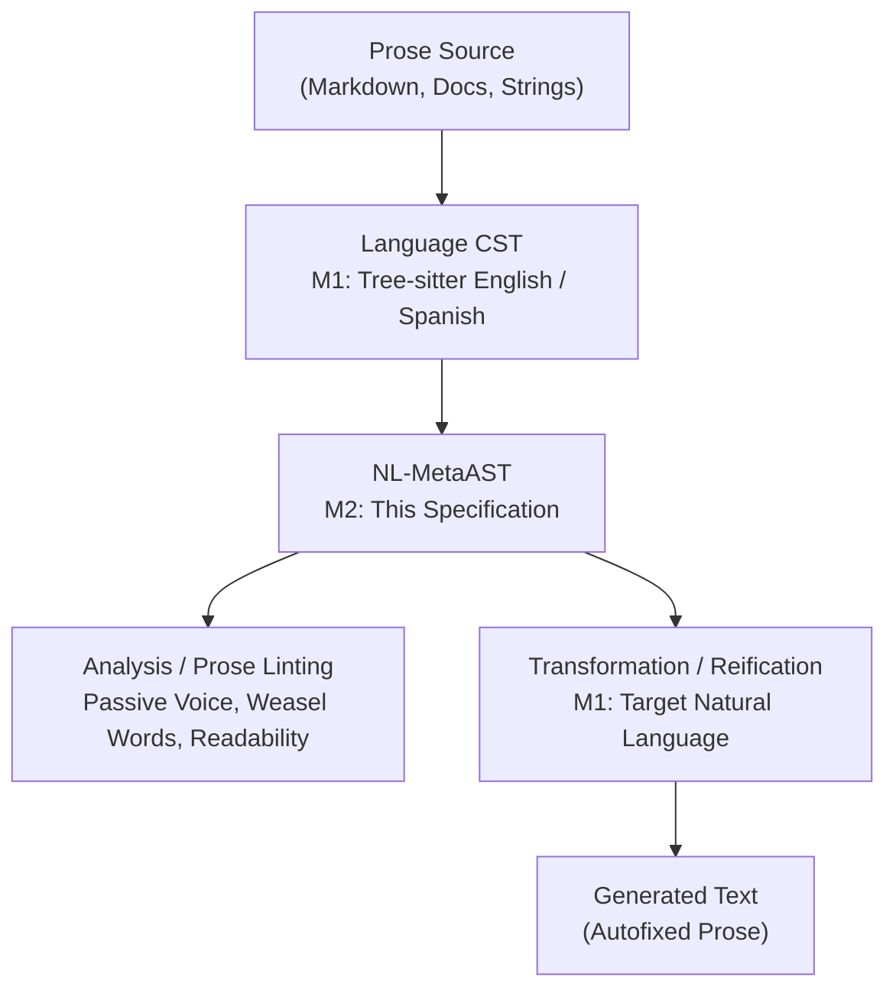

# Natural Language MetaAST (NL-MetaAST) Specification

## What Is NL-MetaAST?

MetaAST was originally designed to represent programming languages (Python, JavaScript, Elixir, Erlang, etc.) in a universal Abstract Syntax Tree. **NL-MetaAST** extends this foundation to **natural languages** (English, Spanish, and others).

In natural language, different human languages express the same underlying semantic intent using different surface grammar and word order:
- English: *"The committee wrote the report."* (Active, SVO)
- Spanish: *"El comité escribió el informe."* (Active, SVO)
- English (Passive): *"The report was written by the committee."* (Passive, Patient-Verb-Agent)
- Spanish (Passive): *"El informe fue escrito por el comité."* (Passive, Patient-Verb-Agent)

NL-MetaAST abstracts these surface representations into a uniform, language-independent representation that captures both the **syntactic structure** and **semantic enrichment** (roles, voice, hedging, readability).



---

## The Four-Level Meta-Modeling Hierarchy

Following Metastatic's theoretical MOF hierarchy:

- **M3 (Type System)**: Elixir typespecs in `Metastatic.NL.AST` defining allowed node types, POS tags, and metadata constraints.
- **M2 (NL-MetaAST)**: Universal representation for natural language discourses, sentences, clauses, phrases, and tokens.
- **M1 (Language-Specific CST)**: Concrete syntax trees produced by Tree-sitter or linguistic tokenizers for English or Spanish.
- **M0 (Runtime Utterances)**: Concrete spoken or written text in documents, READMEs, PRs, and comments.

---

## Format Specification: The 3-Tuple

Every NL-MetaAST node is a uniform 3-element tuple:

```elixir
{type_atom, keyword_meta, children_or_value}
```

- **`type_atom`** — Identifies the node kind (`:document`, `:sentence`, `:clause`, `:phrase`, `:token`, `:punctuation`).
- **`keyword_meta`** — Keyword list carrying linguistic annotations (POS tag, lemma, voice, hedging, syllable count, line, column).
- **`children_or_value`** — String or nil for leaf nodes (`:token`, `:punctuation`), or a list of child nodes for composite nodes.

---

## Three-Layer Architecture

### M2.1: Core Layer (Linguistic Universals)

Universal constructs found across human languages:

- **`:document`** — High-level container of sections and paragraphs.
  ```elixir
  {:document, [language: :en, format: :prose], [paragraph_1, ...]}
  ```
- **`:paragraph`** — Grouping of sentences.
  ```elixir
  {:paragraph, [], [sentence_1, sentence_2]}
  ```
- **`:sentence`** — A complete communicative unit.
  ```elixir
  {:sentence, [kind: :declarative, words_count: 5], [clause, punctuation]}
  ```
- **`:clause`** — Predication containing a verb phrase and arguments.
  ```elixir
  {:clause, [voice: :active, type: :main], [subject_np, verb_vp, object_np]}
  ```
- **`:phrase`** — Syntactic phrase with a head:
  - `:noun_phrase`
  - `:verb_phrase`
  - `:prep_phrase`
  - `:adj_phrase`
  - `:adverb_phrase`
- **`:token`** — Leaf lexical unit carrying text, Universal POS tag, and base lemma.
  ```elixir
  {:token, [pos: :noun, lemma: "report", line: 1, col: 5], "report"}
  ```
- **`:punctuation`** — Syntactic punctuation delimiter.
  ```elixir
  {:punctuation, [pos: :punctuation, col: 40], "."}
  ```

---

### M2.2: Extended Layer (Typological Variations & Semantic Enrichment)

- **Grammatical Voice**:
  - `voice: :active`
  - `voice: :passive`
- **Semantic Roles**:
  - `sem_role: :agent` — The initiator of the action.
  - `sem_role: :patient` — The entity undergoing the action.
- **Hedging & Weasel Word Classification**:
  - `hedging: :weasel` — Ambiguous, evasive, or unsubstantiated claims (*"clearly"*, *"obviously"*, *"probably"*).
  - `hedging: :tentative` — Modals (*"might"*, *"could"*).
- **Readability & Complexity Metrics**:
  - `syllables_count`
  - `flesch_reading_ease` (0–100 score; 60–70 is standard)
  - `flesch_kincaid_grade` (US grade school level)

---

### M2.3: Native Layer (Escape Hatches)

- **`:native_nl_feature`**: Accommodates language-specific phenomena that do not map directly into universal syntax:
  ```elixir
  {:native_nl_feature, [language: :japanese, feature: :particle_wa], "は"}
  ```

---

## Concrete Example: Active vs. Passive Voice

### Active Voice: *"The committee wrote the report."*
```elixir
{:sentence, [kind: :declarative],
 [
   {:clause, [voice: :active, type: :main],
    [
      {:phrase, [type: :noun_phrase, role: :subject, sem_role: :agent],
       [
         {:token, [pos: :determiner, lemma: "the"], "The"},
         {:token, [pos: :noun, lemma: "committee"], "committee"}
       ]},
      {:phrase, [type: :verb_phrase],
       [{:token, [pos: :verb, lemma: "write"], "wrote"}]},
      {:phrase, [type: :noun_phrase, role: :object, sem_role: :patient],
       [
         {:token, [pos: :determiner, lemma: "the"], "the"},
         {:token, [pos: :noun, lemma: "report"], "report"}
       ]}
    ]},
   {:punctuation, [pos: :punctuation], "."}
 ]}
```

### Passive Voice: *"The report was written by the committee."*
```elixir
{:sentence, [kind: :declarative],
 [
   {:clause, [voice: :passive, type: :main],
    [
      {:phrase, [type: :noun_phrase, role: :subject, sem_role: :patient],
       [
         {:token, [pos: :determiner, lemma: "the"], "The"},
         {:token, [pos: :noun, lemma: "report"], "report"}
       ]},
      {:phrase, [type: :verb_phrase],
       [
         {:token, [pos: :auxiliary, lemma: "be"], "was"},
         {:token, [pos: :verb, lemma: "write"], "written"}
       ]},
      {:phrase, [type: :prep_phrase, role: :agent_by_phrase, sem_role: :agent],
       [
         {:token, [pos: :preposition, lemma: "by"], "by"},
         {:phrase, [type: :noun_phrase],
          [
            {:token, [pos: :determiner, lemma: "the"], "the"},
            {:token, [pos: :noun, lemma: "committee"], "committee"}
          ]}
       ]}
    ]},
   {:punctuation, [pos: :punctuation], "."}
 ]}
```

---

## Cross-Lingual Universality

Because rules match on M2 semantic metadata (`voice: :passive`), the **exact same linter rule** detects passive voice in English and Spanish without modifying the rule:

```elixir
# In English:
"The migration was executed by the operator."
# => Flags :avoid_passive_voice, suggests active with actor "by the operator"

# In Spanish:
"La migración fue ejecutada por el operador."
# => Flags :avoid_passive_voice, suggests active with actor "por el operador"
```

---

## Running the Prose Linter

Run the prose linter via the Mix task:

```bash
# Lint project README
mix metastatic.lint.prose README.md

# Lint all documentation files in docs/
mix metastatic.lint.prose docs/
```

### Built-in Rules:
- **`AvoidPassiveVoice`**: Flags passive constructions; recommends active voice with the identified agent.
- **`AvoidWeaselWords`**: Flags words like *"clearly"*, *"obviously"*, *"probably"*, *"perhaps"*.
- **`SentenceLength`**: Flags sentences with more than 25 words.
- **`TerminologyConsistency`**: Enforces modern, inclusive vocabulary (*"allowlist"* instead of *"whitelist"*, *"replica"* instead of *"slave"*).
